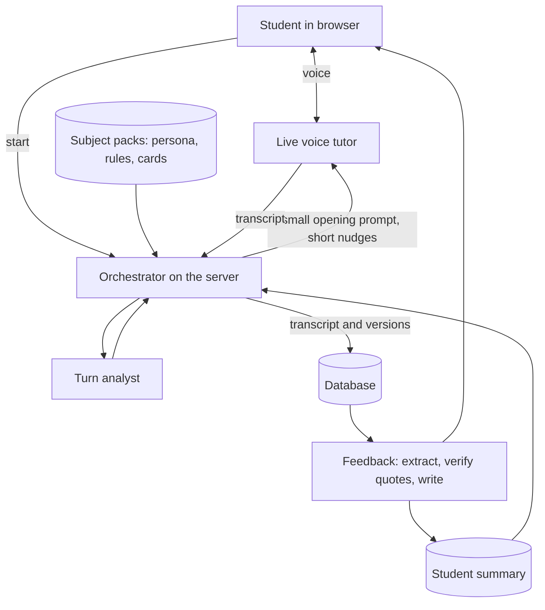

# Architecture vision

A short, plain-language view of where the Compass architecture should go, what to make of the stack, how promising the idea is, and what to keep in mind along the way. The detail lives in three companion documents:

- `interview-pedagogy.md`: how every tutor teaches.
- `multi-subject-interview-architecture.md`: the full technical specification.
- `context-layer-spec.md`: topic cards and per-student memory, ready to implement.

## Where the app is today

One tutor, Dr River, for geography. Every interview sends the same fixed prompt to a live voice model. The server checks sign-in and credits carefully and relays the call, and a single model call writes feedback from a transcript the browser supplies. When the call ends, nothing is kept: no transcript, no feedback, no record of what was covered.

That is a sound first version. The voice relay, the credit rules and Dr River's briefing are the parts worth keeping as they are.

## Where it should go

Three shifts, in this order.

### 1. From one prompt to subject packs

All subject knowledge moves out of the relay code into versioned folders, one per subject. Each pack holds a persona, the subject's rules, its assessment criteria, and a library of short topic cards written in our own words and approved by someone who knows the subject.

Each interview gives the voice tutor a small, chosen slice: the shared teaching method, the persona, and two or three cards. The library can grow to hundreds of cards without the live prompt growing at all. Adding a subject means adding content, not code.

### 2. From forgetting to recording

The server saves its own copy of the transcript, which cards were used, and which prompt and model versions ran. This one change unlocks most of what the product lacks:

- a history page for students;
- school dashboards;
- feedback built from the server's transcript, where every claim links to a quote that code has checked is really there;
- a small, dated summary per student and subject, so the next interview avoids repeated ground and picks up a recurring habit. Observations expire unless seen again, and the student can read and delete them.

### 3. From hoping to measuring

A second model, off the audio path, labels each turn: what skill was tested, how the student responded, whether the tutor led or lectured. At first it only records. Later the server uses it to send the tutor short nudges mid-call: move on, raise the difficulty, stop lecturing.

Alongside it, a fixed set of scripted students and annotated transcripts is re-run on every change. That is how we know whether a new prompt or model made a tutor better or worse, instead of guessing from one test call.

### The shape of the result

The principle behind all of it: the voice model's job stays small. It holds a good conversation. Choosing content, tracking progress, checking evidence and measuring quality happen around it, in code and in slower models that the student never waits on.

One limit to be honest about: a speech-to-speech model answers the student directly, so the server can steer it but not script it. Nudges arrive a turn late and may be ignored. The opening prompt has to be good enough to work alone.

## The stack

TanStack Start with React, Supabase for accounts and data, Stripe for payments, and the Lovable AI gateway for voice and text models. It is a sensible stack for this stage and nothing in it needs replacing.

The thing to watch is concentration: voice, database and payments all run through Lovable, and database changes must be made there. Two habits keep that safe. Keep model names in one configuration file, and keep all tutor content in the repository, where it stays ours whatever platform runs it.

Three tools write code here (Lovable, Codex and Claude). Lovable should own the interface and the database; the others own server logic and content. One branch at a time, merged to main, with the tests run before each merge.

## Potential of the idea

The problem is real. Mock interviews are scarce, expensive and unevenly available, and practising aloud under challenge is exactly what most applicants never get.

The edge is not the AI, which anyone can rent. It is the curated content, a teaching method that can be checked, and feedback a teacher can trust because every point is tied to what the student said.

The limits are real too:

- Demand is seasonal, concentrated in the autumn.
- Each subject is a small market, and geography is one of the smaller ones.
- Schools take a full cycle to trust a new tool.
- Each new subject needs a specialist to review it.

This can be a good small business on geography and one or two neighbouring subjects. Whether it becomes a large one depends on covering the high-demand subjects well, and on evidence that students come back and improve.

## What to keep in mind

1. **One paying user before more building.** Evidence that someone pays and returns is worth more than any feature in these documents.
2. **Quality comes from review, not volume.** A card nobody qualified has checked is a liability. More source material does not make a better tutor.
3. **Be exact about claims.** Tutors are fictional. No real academics' names, no implied endorsement, no promises about admission, and "Oxford-style" for PPE.
4. **Use other people's material as inspiration, not content.** Link to sources and write the ideas in our own words.
5. **Most users are under 18.** Retention, deletion, safeguarding and a rewritten privacy notice come before stored transcripts and before schools.
6. **Find out what the voice provider keeps.** Schools will ask where student audio goes.
7. **Watch usage on unlimited plans.** Every added model call multiplies across every interview.
8. **Change one thing at a time and measure it.** The scripted students and annotated transcripts are what stop the product drifting.
9. **Fairness includes speech recognition.** It makes more mistakes with some accents; a garbled turn is never evidence against a student.
10. **Sell in season.** Students and parents in the autumn; schools from spring for the following cycle.
11. **Two subjects prove the design.** Add a third only when the first has returning users.

## Suggested order of work

1. Confirm payments work end to end with a real purchase.
2. Subject packs and topic cards for geography (no database change).
3. Save transcripts and show a history page; update the privacy notice first.
4. Evidence-checked feedback.
5. School accounts.
6. A second subject, with a named reviewer.
7. Turn analysis, then mid-call steering, then student memory.
