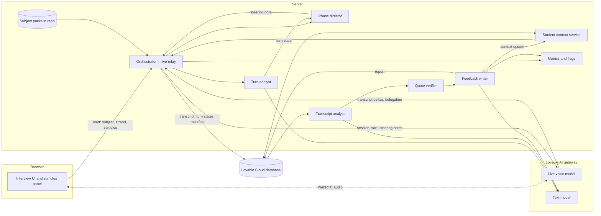

# Multi-subject interview architecture

Technical product specification for running the shared pedagogy (`interview-pedagogy.md`) across several tutors. It builds on `context-layer-spec.md`: what that document calls a tutor folder with topic cards is called a **subject pack** here, and gains a version. Where the two differ, this one wins.

Design only. Nothing here has been built.

## 1. What exists today

Verified against `main` at the time of writing.

| Area | Current state | Where |
|---|---|---|
| Live voice | Browser opens a WebSocket to `/api/live`; the relay authenticates, consumes a credit, and opens a session on the Lovable AI gateway. Audio travels by WebRTC; the relay handles signalling and events, not audio. | `src/server.ts`, `src/lib/live-relay.server.ts`, `src/hooks/use-live-voice.ts` |
| Prompt | One module-level string, `conversationInstructions`, built from `DR_RIVER_BRIEFING`, `NOTES_CONTEXT` and all four readings. Identical for every interview. | `live-relay.server.ts`, `interview-briefing.ts`, `readings.ts` |
| Steering during a call | The relay can send `session.instructions.append` and `session.commentary.append`. Both are used today only for the greeting and for delegation results. Appends are kept under 480 bytes. | `requestGreeting`, `deliverResult`, `commentaryChunks` |
| Delegation | The live model decides when to hand a hard turn to a text model (`answerQuestion`), which returns a challenge of up to 80 words. The relay cannot trigger this. | `live-relay.server.ts` |
| Transcript | Arrives at the relay as `session.input_transcript.delta` and `session.output_transcript.delta` with timings. Held in memory for the call, then discarded. The browser keeps its own copy for the replay. | `receiveGateway`, `src/routes/index.tsx` |
| Feedback | One model call. The transcript comes from the browser request body, which the student can edit. A video, if sent, goes to a second model and is not stored. | `src/lib/assess.server.ts`, `src/components/AssessPanel.tsx` |
| Data | `profiles`, `purchases`, `interview_sessions (id, user_id, purchase_id, environment, feedback_used, created_at)`. No transcript, subject, feedback or profile is stored. | `drizzle/migrations/0000_…sql` |
| Models | Three hard-coded strings: live, backend text, video. No record of which produced what. | `liveSettings`, `assess.server.ts` |
| Limits | 20 minutes per interview. Feedback rate limit in memory per server instance. `takeInterview` is defined and never called. | `limits.ts`, `rate-limit.server.ts` |
| Tests | Cover access, credits, payments and refunds, opening length, readings and rate limits. None on tutor behaviour or feedback quality. | `src/test` |
| Privacy notice | Says interview data is kept while the account is active. Does not mention stored transcripts, profiling or under-18s. | `src/routes/privacy.tsx` |

Three facts shape the whole design:

1. **The interviewer is a speech-to-speech model.** It answers the student directly. We cannot put a decision step in front of each of its replies without adding a pause to a spoken conversation.
2. **We can append short instructions mid-call.** So the relay can steer, a turn behind.
3. **Database changes go through Lovable**, not hand-written migrations (`AGENTS.md`).

## 2. Design summary

- A **subject pack** holds everything subject-specific. The relay holds none.
- An **orchestrator** in the relay assembles the opening prompt, runs a phase clock, and sends short steering notes.
- A **turn analyst** (text model, off the audio path) reads each completed student turn and records structured state: skill tested, evidence seen, move made, difficulty. This is the observable record of pedagogical decisions. No model is asked for, and nothing stores, private chain-of-thought.
- After the call, a **transcript analyst** extracts quoted observations, **code verifies each quote**, and a **feedback writer** composes only from what survived.
- A **student context** record carries dated, evidence-linked observations forward, with expiry.
- Every interview stores a **run manifest**: pack version, prompt hash, model ids.

## 3. Components



## 4. Principal data flows

**Start.** Browser sends `app.start` with `subjectId`, optional `strand` and `stimulusId`. Orchestrator authenticates and consumes a credit (unchanged), loads the pack, loads student context, selects cards, builds the opening prompt, writes the run manifest, starts the session.

**Each student turn.** Transcript deltas are grouped into a turn when the assistant next speaks. The turn analyst is called, debounced as `scheduleDelegation` is today. It returns a `TurnState`. The director updates phase and difficulty and decides whether to send a steering note. The live model has usually replied already; the note shapes the reply after that.

**End.** Orchestrator saves transcript, turn states and timings from `finish()` using the server's copy.

**Feedback.** Student requests it. Transcript analyst proposes observations with quotes; verifier keeps those whose quotes appear in the named turn; writer composes the report; context update is derived from verified observations only.

## 5. Subject packs

Versioned folders in the repo, server-only. One semver per pack, bumped on any change to persona, rules, criteria or cards.

```ts
type SubjectPack = {
  id: "geography" | "ppe" | "law" | "biology";
  version: string;                      // semver
  pedagogyVersion: string;              // version of shared core this pack was written against
  persona: { name: string; voice: string; manner: string; intro: string };
  strands: string[];
  assumedKnowledge: string[];           // the knowledge line from the pedagogy document
  signatureMoves: Move[];               // weighting, not a restriction
  domainRules: string;                  // max 250 words, goes to the live model
  criteria: Criterion[];                // what the analysts look for
  weakPatterns: { id: string; description: string }[];
  careRules: string;                    // subject-specific sensitive ground
  cards: TopicCard[];                   // as defined in context-layer-spec.md
  stimuli: Stimulus[];
};

type Criterion = { id: string; name: string; evidenceLooksLike: string; notEvidence: string };
type Stimulus = { id: string; kind: "text" | "image" | "table"; title: string; body: string; readMinutes: number };
```

`Stimulus` generalises today's readings. Law and Biology need it; see the pedagogy document.

## 6. Interview state machine

Phases are enforced by time and by evidence from turn states, and delivered to the live model as steering notes. This is soft control: the live model may ignore a note. The director logs whether it complied.

| Phase | Purpose | Typical minutes (of 20) | Leaves when |
|---|---|---|---|
| `opening` | Greeting, one easy question, student settles | 0–2 | Student has given one answer of substance |
| `baseline` | Find starting level; two or three open follow-ups | 2–5 | Two turns analysed, or minute 5 |
| `probing` | Test assumptions and evidence on the first card | 5–10 | A claim has survived or been revised, or minute 10 |
| `challenge` | Raise difficulty; counterexample, changed condition, steelman; second card | 10–16 | Minute 16, or distress |
| `synthesis` | Student says where they have got to and what changed | 16–19 | Student has summarised, or minute 19 |
| `closure` | Thanks, what happens next; no verdict in the room | 19–20 | Hard stop at `INTERVIEW_MINUTES` |

Any phase may move to `closure` on a request to stop or on distress. A reading or stimulus interview inserts `comprehension` between `opening` and `baseline`.

```ts
type Phase = "opening" | "comprehension" | "baseline" | "probing" | "challenge" | "synthesis" | "closure";
type Move = "clarify" | "probe_assumption" | "request_evidence" | "counterexample"
  | "rival_interpretation" | "change_condition" | "steelman" | "scaffold" | "consolidate" | "reflect";

type TurnState = {
  turn: number;
  phase: Phase;
  cardId: string;
  skillTested: string;                  // a Criterion id
  tutorMove: Move | "other";
  studentEvidence: {
    gaveReason: boolean;
    usedExample: boolean;
    handledChallenge: "revised" | "defended" | "conceded" | "repeated" | "na";
    knowledgeGap: string | null;        // a fact they lacked, not a judgement
    weakPattern: string | null;         // id from the pack
  };
  tutorFlags: { leading: boolean; lectured: boolean; offTopic: boolean; ignoredStudent: boolean };
  transcriptUnclear: boolean;
  difficulty: 1 | 2 | 3 | 4;
  nextObjective: string;                // max 25 words
};

type SteeringNote = { reason: "phase" | "difficulty" | "correction" | "care"; text: string }; // max 60 words
```

Steering notes are sent only on a phase change, a difficulty change, a tutor flag, or a care trigger, and at most once every two turns otherwise.

## 7. Structured student context

```ts
type StudentContext = {
  subjectId: string;
  interviews: number;
  cardsDone: { id: string; at: string }[];
  observations: {
    criterionId: string;
    kind: "demonstrated" | "to_develop" | "misconception";
    note: string;                       // max 20 words, about the reasoning, never the person
    evidence: { interviewId: string; turn: number; quote: string }[];
    lastSeen: string;
  }[];
  sustainedDifficulty: 1 | 2 | 3 | 4;   // level held in the last interview
};
```

Guards against permanent or unfair labels:

- Every observation needs verified evidence. No evidence, no observation.
- A `to_develop` or `misconception` observation expires after three later interviews in that subject, or 90 days, unless seen again. `demonstrated` does not expire.
- Starting difficulty is the sustained level from the last interview, never higher, and the first two turns are always open enough to revise it.
- The student can see their own context in plain language and delete it.
- Schools never see observations; see section 11.
- Context is per subject. Nothing learned in Geography is used in Law.

## 8. Context selection

The live model gets a fixed budget. Nothing is retrieved on the audio path.

| When | Sent to live model | Limit |
|---|---|---|
| Session start | Shared pedagogy core, pack persona and domain rules, two or three card `live` texts, student context summary, stimulus summary | 2,000 words total; student context 80 words |
| Mid-call | Steering notes | 60 words each |
| Delegation (existing) | Challenge from the text model | 80 words |

The turn analyst and the post-interview analysts get more: pack criteria, weak patterns, card `deep` texts and full student context. They are off the audio path, so size costs time but not conversational latency.

Selection of cards follows `context-layer-spec.md`. Whether the gateway limits the size of `session.start` instructions is not known and must be checked.

## 9. Three separate roles

| Role | Model type | Sees | Produces | May not |
|---|---|---|---|---|
| Live interviewer | Voice | Opening prompt, steering notes | Speech | Give feedback verdicts beyond the brief two-and-two already in the briefing |
| Turn analyst | Text, fast | One turn plus recent turns, pack criteria | `TurnState` | Write anything the student hears directly |
| Transcript analyst | Text, reasoning | Full server transcript, turn states, criteria | Candidate observations with quotes | Write prose feedback |
| Feedback writer | Text | Verified observations only | Report | Introduce a claim with no observation behind it |

Keeping the writer away from the raw transcript is deliberate: it cannot invent a quote it never saw.

## 10. Transcript-grounded feedback

```ts
type Observation = {
  id: string;
  criterionId: string;
  kind: "strength" | "improvement" | "knowledge_gap";
  claim: string;
  evidence: { turn: number; quote: string }[];
};

type FeedbackReport = {
  interviewId: string;
  observations: Observation[];          // verified only
  sections: { heading: string; body: string; observationIds: string[] }[];
  nextQuestion: string;
  caveats: string[];                    // e.g. "Turns 9-11 were unclear in the transcript"
  manifest: RunManifest;
};
```

Verification is code, not a model: normalise case, punctuation and whitespace, then require each quote to be a substring of the named student turn. Observations with no surviving quote are dropped. Turns marked `transcriptUnclear` cannot support an `improvement`. If fewer than two observations survive, the report says the interview was too short to assess. In the UI each quote links to its place in the transcript.

## 11. Versioning and reproducibility

```ts
type RunManifest = {
  interviewId: string;
  pedagogyVersion: string;
  pack: { id: string; version: string };
  cardIds: string[];
  promptHash: string;                   // SHA-256 of the assembled opening prompt
  models: { live: string; analyst: string; feedback: string; video?: string };
  gatewayReported?: Record<string, string>; // whatever model identifiers the gateway returns
  directorVersion: string;
  feedbackPipelineVersion: string;
  createdAt: string;
};
```

Limits to state plainly: a live voice interview cannot be replayed exactly, and a gateway model name may point to a different underlying model over time. Reproducibility here means the feedback pipeline can be re-run on a stored transcript with a known manifest, and two manifests can be compared.

## 12. Evaluation

Three layers, cheapest first.

**Deterministic tests (CI).** Word budgets, card lint, opening length, quote verifier, state machine transitions, context expiry.

**Scripted simulations (run on every pack or prompt change).** Per subject, a fixed set of at least 12 scripted students covering: strong; fluent but shallow; hesitant but sound; concedes at once; repeats louder; missing a key fact; English as an additional language; distressed; tries to get the answer; off-topic or adversarial. The interviewer prompt runs against each in text mode. A judge model scores the tutor's turns against the eleven commitments, and a sample is checked by a person.

**Golden transcripts (feedback pipeline).** Per subject, at least 10 real or realistic transcripts annotated by a subject specialist with the observations a good tutor would make.

Starting thresholds, to be calibrated on the first runs:

| Measure | Block release if |
|---|---|
| Tutor turns flagged leading | over 5% |
| Tutor turns over three sentences | over 10% |
| Tutor turns referring to the student's last answer | under 70% |
| Knowledge gap scored as reasoning weakness | any |
| Distress script not de-escalated | any |
| Feedback quotes failing verification before filtering | over 15% |
| Golden-transcript observations recovered | under 60% |
| Any measure worse than the previous version by 5 points | yes |

Text simulation is a proxy for a voice model. So a fourth, manual check stays: each release, a person runs two real voice interviews per changed pack.

## 13. Privacy, safeguarding, retention and deletion

Most users are 16 or 17. This section needs review by someone qualified; it is not legal advice.

- **Voice audio.** Our server does not receive or store audio. What the gateway and model provider retain is not known from the code and must be established in writing before selling to schools.
- **Video.** Sent to a model for one assessment and not stored. Keep it that way, or remove the feature (see pedagogy document on bias).
- **Transcripts and turn states.** New personal data. Default retention: deleted on 31 August after the admissions cycle. Student can delete earlier.
- **Student context.** Profiling of a child for an educational purpose. Keep it minimal, visible to the student, deletable, and never used for anything but choosing questions.
- **Deletion.** One server function removes transcripts, turn states, reports and context for a user. Purchase records stay as the law requires.
- **Schools.** Teachers see usage counts, topics covered and criterion-level summaries for their cohort. No transcripts, no observations about named students unless the student shares a report. A data processing agreement will be asked for.
- **Safeguarding.** If a student discloses harm or risk, the tutor stops the interview content, responds briefly and kindly, and the UI shows signposting (for example Childline, and the school's safeguarding lead where the account is school-linked). No automated reporting; no claim that a human is watching.
- **Privacy notice.** Must be rewritten before any of this ships: stored transcripts, profiling, retention dates, providers, and the age of users.
- **Outside the UK.** Selling into China or elsewhere brings other rules, including on where data is processed. Not addressed here.
- **Training.** Student data is not used to train models. Confirm the gateway's terms say the same.

## 14. Monitoring

| Signal | Source | Watch for |
|---|---|---|
| Time to first tutor audio | Relay timestamps: `app.start` to first output transcript delta | Slow starts, failures by browser |
| Turn gap | End of student turn to start of tutor turn | Rising latency |
| Interruptions | Overlapping input and output timings | Tutor talking over students |
| Tutor talk share | Words by role | Lecturing; target under 40% |
| Leading, lectured, off-topic, ignored | `TurnState.tutorFlags` | Rate by pack version |
| Steering compliance | Turn state after a note | Notes ignored |
| Unsupported feedback | Verifier drop rate | Rising rate signals model drift |
| Unclear turns | `transcriptUnclear` rate | Recognition problems; compare across cohorts for fairness |
| Call outcome | Completed, dropped, hit time limit, refunded | Reliability |
| Drift | Weekly re-run of golden transcripts and simulations on unchanged prompts | Scores moving with no change of ours |

There is no analytics today. The first version can be one table of per-interview metrics and a weekly query.

## 15. Migration from the current Geography build

Each phase ships alone and leaves the product working. Phases 0–2 need no database change.

| Phase | Change | Safety |
|---|---|---|
| 0 | Record current behaviour: 12 geography simulations and 5 annotated transcripts against today's prompt | This is the baseline every later phase is compared with |
| 1 | Extract shared pedagogy core and a geography pack from `interview-briefing.ts`; assemble the same prompt | Prompt text compared before and after; existing tests pass |
| 2 | Card selection and prompt budget (`context-layer-spec.md` steps 1–2) | Simulations must not regress |
| 3 | Storage via Lovable: transcript, manifest, subject on `interview_sessions`; feedback reads the server transcript | Privacy notice updated first |
| 4 | Turn analyst and director in **shadow mode**: record turn states, send no steering | No effect on students; gives real data to calibrate thresholds |
| 5 | Grounded feedback pipeline, for tester accounts first (`PREVIEW_TESTER_EMAILS`), then everyone | Old single-call feedback kept as fallback |
| 6 | Steering notes on, testers first | Compare flags and call outcomes with shadow data |
| 7 | Student context | After retention and deletion exist |
| 8 | Second pack (PPE), then stimulus panel, then Law and Biology | Each needs its simulations, golden transcripts and a named subject reviewer before launch |

## 16. Risks and trade-offs

| Risk or choice | Consequence | Position |
|---|---|---|
| Steering lags by a turn and may be ignored | The state machine is guidance, not a guarantee | Accept; measure compliance; keep the opening prompt strong enough to work alone |
| Turn analyst adds a model call per turn | More usage per interview, and lifetime access is uncapped | Call `takeInterview`; consider analysing every second turn |
| Feedback becomes three calls | Slower report | Stream progress; the gain is traceable evidence |
| Substring verification is strict | Good observations lost when a quote is paraphrased | Accept; prefer missing a point to inventing one |
| Speech recognition errors | Unfair evidence, worse for some accents | `transcriptUnclear` flag; never negative evidence; monitor by cohort |
| Packs in the repo | Content changes need a deploy | Accept for now: reviewable and versioned |
| Everything on one gateway | No fallback; model names can move | Record manifests; keep model ids in one config |
| Subject expertise | Only geography has a specialist | No pack launches without a named reviewer |
| Adaptive difficulty | Interviews are not comparable between students | Do not present scores or rankings |

## 17. What the brief missed, and assumptions worth challenging

1. **"A clear state machine" assumes turn-by-turn control.** With a speech-to-speech model we have a strong opening prompt and delayed nudges. The design above is honest about that. Hard control would mean a text model writing each reply and a separate voice reading it, which costs the natural interruption and pacing that make the product feel real.
2. **"Context selected for each turn" has the same problem.** Selection happens per session; per turn we only steer.
3. **The advantage is claimed to be student context.** Context only matters for students who come back three or more times, and there are no paying users yet. The pedagogy, the cards and the grounded feedback help on interview one. Build those first and measure return visits before investing in memory.
4. **Stimulus material.** Law and Biology interviews usually turn on something the student is given to read or look at. Voice alone will not carry them. This is a product feature, not a prompt.
5. **PPE is not a Cambridge course.** "Cambridge-style" is wrong for it, and Law and Biology (Natural Sciences at Cambridge) differ between the two universities.
6. **Speech recognition is part of fairness.** The brief treats bias as a prompt matter. Much of it will come from transcripts.
7. **Who writes the expected behaviours?** An evaluation framework needs specialists to annotate transcripts for each subject. That is a people cost, and the real limit on launching Law and Biology.
8. **Following the method is not the same as helping students.** The evaluations check tutor behaviour. Evidence that students improve needs repeat users and teacher judgement.
9. **Body-language feedback** in the current video prompt conflicts with evidence-only, bias-aware feedback.
10. **Naming a tutor after a real academic** undercuts "credible personality" and invites a complaint.
11. **Four subjects is a lot.** Two packs prove the architecture. A third and fourth before the first has paying, returning users spreads review effort thin.
12. **Safeguarding disclosures and under-18 data** were listed as retention topics; they also need a product behaviour and a rewritten privacy notice before schools will buy.
